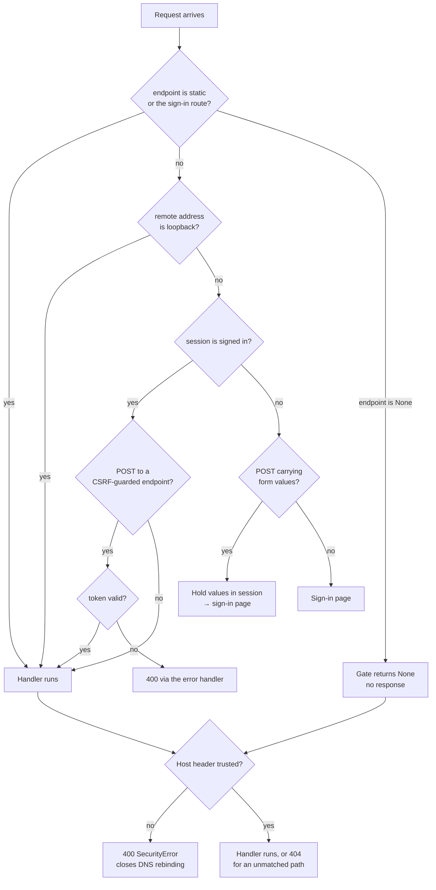

# Phone Capture Logging - Plan

## Goal Capsule

- Objective: let the owner log an item into PRIMS from their iPhone, by speaking rather than typing, with the item confirmed before it is written.
- Product authority: this plan owns the capture tool and the access path that makes it reachable. Automatic categorisation of captured items is a separate work unit and is not active scope.
- Authority order: a requirement (R-ID) wins on product behaviour; a Key Technical Decision (KTD-ID) wins on mechanism within its cited requirements; a unit overrides neither.
- Stop conditions: stop and ask if meeting a requirement would need TLS on the LAN, a new runtime dependency beyond Waitress, or a change to how items are stored.
- Open blockers: none.

**Product Contract preservation:** changed — R4 and AE5. Research established that iOS Safari restricts password autofill to HTTPS origins, so the original mechanism ("the phone stores the password") cannot work over plain HTTP. Both were reworded to the mechanism that does work: the password is typed at most once per device, held by a long-lived session. Intent unchanged. R12–R15 were added for behaviour the brainstorm implied but never stated. R1–R3 and R5–R11 are unchanged.

---

## Product Contract

### Summary

Expose PRIMS so the owner's iPhone can reach it at a stable address, put a password in front of it, and give it an add-item screen shaped for one-handed use and the phone's built-in dictation. Every capture prefills the existing item form, which the owner confirms before anything is written.

### Problem Frame

PRIMS holds no real inventory. The database at the repo root contains only `src/seed.py` sample data — 47 items across Kitchen, Library and Records — so the system has never held anything the owner actually owns.

The reason is where logging has to happen. Things enter a household in a moment: unpacking a bag, shelving a delivery, putting something away. The owner is standing in the room holding the object. PRIMS answers only on `127.0.0.1`, so in that moment it cannot be reached at all, and the alternative — remember the thing, walk to the laptop, type it in later — loses to doing nothing. The add-item form is already laid out for a phone; no phone can open it.

The cost is silent. Nothing errors, nothing fails, the inventory simply stays a demo. The owner expects a large first pass over what they already own and then a trickle as new things arrive, and both phases break at the same seam: the moment of capture and the machine that records it are in different rooms.

### Key Decisions

- **Scope this plan to capture and leave categorisation to a later plan.** An uncategorised item still beats an unlogged one, and auto-filing needs the real items and real vocabulary that capture produces first. (session-settled: user-approved — chosen over planning capture and auto-filing as one engine: the two have separate value and separate acceptance boundaries.) Governs R1, R10.
- **Confirm every captured item before it is written.** Nothing wrong reaches the inventory, at the cost of one confirmation per item. (session-settled: user-directed — chosen over writing straight through, and over collecting drafts for one batch review: trust in the inventory matters more than capture speed.) Governs R6.
- **One capture produces at most one item.** It follows from having a single confirmation form, and keeps the first version on the existing save path. (session-settled: user-approved — chosen over splitting one capture into several items: multi-item capture needs a staging concept this plan does not introduce.) Governs R7.
- **No model in this version; the phone's own dictation supplies the words.** It ships with no new dependency, no API key and no per-capture cost, and proves whether phone logging becomes a habit before that is bought. (session-settled: user-directed — chosen over a model-backed route that would also read photographs: that route is the named next step, not this one.) Governs R5, R8.
- **Exposing the app and securing it are one piece of work, not two.** The app currently serves an interactive debugging console and has no access control, so making it reachable and making it safe cannot be sequenced apart. Governs R2, R3, R14.
- **Guard access with a password, not a secret link or network trust alone.** A password keeps others out without making the address itself the credential. (session-settled: user-approved — chosen over a bookmarked secret link, which leaks through history and sharing, and over trusting the home network, which would mean dropping the exclusion requirement rather than meeting it.) Governs R3, R4.
- **Hold the session open for a year rather than adding TLS to the LAN.** iOS Safari will not autofill a password over plain HTTP, so the password is typed once per device and a long, sliding session keeps it from being asked again. (session-settled: user-approved — chosen over a Tailscale or Caddy certificate: TLS on a home LAN is more machinery than this app's value justifies, and a session that never expires removes the need for autofill entirely.) Governs R4.

<!-- ce-section: work-relationships -->
### How This Work Fits Together

This plan owns getting an item from the owner's hands into the database from a phone. The breakdown below is how the surrounding work is currently understood, not a committed roadmap.

- Automatic categorisation — files captured items under the right Category.
  - Depends on this plan for a supply of real items, and for the category vocabulary those items establish.
  - Can proceed independently of model-backed capture.
- Model-backed capture — photograph capture, and turning a spoken or typed sentence into separate fields.
  - Depends on this plan for the phone-reachable, confirm-before-write surface it would feed.
  - Enables photograph capture, which this plan does not provide at all.
  - Inherits a TLS requirement this plan avoided: browser-side audio and the Web Speech API are secure-context-gated, so a capture route that records in the page needs HTTPS even though keyboard dictation does not.
  - Still to decide: whether captures may be sent to a third-party service.

### Requirements

**Reach and safety**

- R1. The owner can open PRIMS from their own phone while on the same local network as the machine running it.
- R2. The application serves no interactive debugging console, and no other remote-code path, once it is reachable from another device.
- R3. Another person on the same network who finds the address cannot read or change the inventory.
- R4. The owner types the password at most once per device. A signed-in phone stays signed in across application restarts and across days of not using it.
- R12. The owner can sign out of a device. Signing out on one device leaves other devices signed in.
- R13. An error never leaves the owner on a page with no way back to the inventory.
- R14. The application refuses to start when it would be reachable beyond the local machine with no password configured.
- R15. The address the owner bookmarks keeps working when the machine's network lease changes.

**Capturing an item**

- R5. The add-item screen accepts spoken input through the phone's own keyboard dictation, with no separate recording step.
- R6. A capture prefills the item form and waits there; nothing is written until the owner confirms.
- R7. One capture produces at most one item.
- R8. Quantity can be set without the keyboard, through a direct on-screen control.
- R9. The screen is usable one-handed: every field a typical capture needs is reachable without zooming or scrolling sideways.

**What the capture produces**

- R10. An item can be saved without choosing a Category, and is reachable afterwards through the existing uncategorised view.
- R11. A confirmed capture is indistinguishable from an item added through the existing form — same fields, same validation, same record.

### Key Flows

- F1. Log an item by speaking
  - **Trigger:** the owner is holding a new item and has their phone.
  - **Steps:** opens PRIMS on the phone; taps add; taps into the name field and dictates the item; sets quantity with the on-screen control; optionally dictates a note; confirms.
  - **Outcome:** one item exists, under whichever Category the owner picked, or none.
  - **Covers R1, R5, R6, R7, R8, R9, R10.**
- F2. Correct a mishearing before it is saved
  - **Trigger:** dictation produced the wrong words.
  - **Steps:** the owner edits the field in place or dictates it again, then confirms.
  - **Outcome:** the item is written once, correctly; nothing was written before the correction.
  - **Covers R6.**
- F3. Reach the app from the phone
  - **Trigger:** the owner opens the bookmarked address on their phone.
  - **Steps:** the app answers on the local network; the session cookie identifies the phone, or the owner signs in; the inventory loads.
  - **Outcome:** the owner is in, and another person on the same network is not.
  - **Covers R1, R2, R3, R4, R15.**
- F4. First run
  - **Trigger:** a fresh checkout, or the first time the owner wants phone access.
  - **Steps:** install dependencies; run the setup command to choose a password, which also writes a stable signing key; start the app bound to the network; clear the operating system's firewall prompt; open the machine's `.local` address on the phone; sign in once.
  - **Outcome:** the phone is signed in and stays signed in. A machine with no password configured refuses to start when bound beyond loopback.
  - **Covers R4, R14, R15.**

### Acceptance Examples

- AE1. **Covers R6.** Given the owner dictates "three pint glasses, two are chipped", when the capture completes, then the form is prefilled and waiting, and no new row exists until they confirm.
- AE2. **Covers R7, R10.** Given a single capture names two different kinds of thing, when the owner confirms, then exactly one item is created and it is the owner who decides how to reword or split it.
- AE3. **Covers R3.** Given a second device on the same network opens the address, when it has not supplied the password, then it can neither read nor change the inventory.
- AE4. **Covers R2.** Given the app is reachable from another device, when a request raises an unhandled error, then no interactive debugging console is served in the response.
- AE5. **Covers R4.** Given the owner signed in on their phone once and the application has since been restarted, when they open PRIMS the next day, then they reach the inventory without signing in again.
- AE6. **Covers R10, R11.** Given a capture is confirmed with no Category chosen, then the item appears in the uncategorised view and carries the same fields as one added through the existing form.
- AE8. **Covers R14.** Given no password has been configured, when the application is started bound beyond the local machine, then it refuses to start and says why.
- AE9. **Covers R12.** Given the owner is signed in on two devices, when they sign out on one, then the other stays signed in.
- AE10. **Covers R13.** Given a request fails or names something that does not exist, then the response is a PRIMS page carrying a link back to the inventory.

### Success Criteria

- Real inventory replaces seed data. The signal is that non-seed items exist, not that the screens render.
- One item can be logged in a single uninterrupted interaction, without switching devices and without typing a word by hand.
- The owner is still using it after the first cataloguing session. The trickle phase is the real test; the first big pass will happen on enthusiasm either way.
- The phone is asked for the password once. A second prompt inside a month means the session or the signing key is not persisting, and the feature has failed at its most-used point.

### Scope Boundaries

Deferred for later:

- Photograph capture, and any model that turns a sentence or an image into structured fields. This is the named next step.
- Automatic categorisation of captured items.
- Producing several items from one capture.
- Reaching PRIMS from outside the home network.
- Tooling built specifically for the large first cataloguing pass.
- Clearing the 47 seeded demo items. The only route today is the destructive seed script, run at the machine. The first real captures land alongside the demo data.
- Giving the assertion-free curl smoke script real assertions. It is a recorded known gap and stays one.
- Recovering a part-filled capture across an expired session. The year-long sliding session makes the lapse rare, and holding submitted values pre-authentication opened an injection surface into the confirm screen that cost more to close than the case was worth. Revisit if real use shows sessions lapsing mid-form.
- Accounts and multi-user access. The app stays single-owner; R3 is about keeping others out, not about letting others in.

Accepted, and recorded rather than fixed:

- Traffic crosses the local network in clear, including the password on the one sign-in and the session cookie on every request. Accepted for a home network; TLS was weighed and rejected as more machinery than this app's value justifies.
- The `.local` name is spoofable. mDNS is unauthenticated, so any device on the network can answer for it and serve a convincing "your session expired" page over plain HTTP, with no certificate whose absence the owner could notice. The exposure is therefore active and repeatable, not only passive capture. The one-prompt property in Success Criteria is the only available signal, and the README says so.
- No lockout after repeated wrong passwords. A minimum interval between attempts and a password floor at setup (KTD12) bound the rate without locking the owner out, and failed attempts are logged so the exposure is observable.
- A captured session cookie is a year-long credential. Signing out clears the device in hand; a lost phone is handled by incrementing the session epoch with `--sign-out-everywhere`, which signs out every device without disturbing the signing key. Changing the password does not do this, by design.

### Dependencies / Assumptions

- The moment of capture is assumed to be at home, on the same network as the machine running PRIMS.
- The phone's built-in dictation is assumed good enough for item names and short notes. This is unverified against real use; if it turns out not to be, the case for model-backed capture strengthens rather than weakens.
- Keyboard dictation needs no secure context. It is a system keyboard function that inserts characters through ordinary text input, processed on-device, and the page never sees an API. Verified against Apple's documentation and MDN's list of secure-context-restricted features.
- Safari is assumed to retain a server-set session cookie for months of regular use. Safari's seven-day storage cap applies to cookies written by script, not to cookies set by a response header. Safari does clear data for sites untouched for thirty days, so a month away means signing in again. This assumption carries R4 and is worth confirming during the first fortnight of real use.
- The machine running PRIMS must be on, and running the app, when the phone tries to reach it. Nothing in this plan changes that.
- The data layer already rejects bad input with errors the routes turn into user-facing messages. Capture inherits that contract for validation. Authentication errors are outside it and are handled by this plan.

### Outstanding Questions

Deferred to Planning — now resolved, recorded as KTD1, KTD4, KTD6 and KTD7.

---

## Planning Contract

### Key Technical Decisions

- KTD1. **A `before_request` gate that denies by default, keyed on `request.endpoint`, exempting the static endpoint, the sign-in route, and requests originating from loopback.** The existing CSRF hook is an allowlist of three endpoint names and fails open, so any new route is unguarded by default; copying that shape would make the capture route public. Exempting loopback keeps the scriptable JSON API and the curl smoke script working from the machine itself while closing them to the network. (session-settled: user-approved — chosen over mirroring the existing allowlist, and over gating page routes only: page-only gating leaves sixteen JSON and file endpoints readable and writable from the network.) Governs R3, R14.
  - **The loopback exemption is only safe in the presence of `TRUSTED_HOSTS`.** Without host validation, any web page can rebind its own DNS to `127.0.0.1`, reach the app same-origin through the browser on the PRIMS machine, and read and write everything — the exemption becomes the way around the gate rather than a convenience within it. The two ship together in U2; neither is complete alone.
  - **The gate must `return None` when `request.endpoint is None`, and must never render its own 404.** Host validation does not front the gate: Flask catches the host `SecurityError` while building the URL adapter and defers it to `dispatch_request`, which runs *after* every `before_request` handler. A gate that answers the unmatched-path case itself short-circuits dispatch and silently deletes the rebinding protection — and the obvious test still passes, because the gate's own 404 also reads as a refusal. Assert the status is specifically 400.
  - **Read the origin from `request.remote_addr` only.** `request.access_route` returns the attacker's `X-Forwarded-For` header verbatim — verified on this machine: a request from `192.168.1.55` carrying `X-Forwarded-For: 127.0.0.1` reports `remote_addr` `192.168.1.55` and `access_route` `['127.0.0.1']`. Using `access_route`, `X-Forwarded-For`, `ProxyFix`, or Waitress's `trusted_proxy` turns one identifier into an open door. Do not use them.
  - **Loopback means `127.0.0.1`, `::1`, or `::ffff:127.0.0.1`.** A dual-stack socket reports the IPv4-mapped form. Missing one fails closed — the curl script stops working rather than the gate opening — which is the right direction, but predict it here rather than debug it later.
- KTD2. **Register the gate before the existing CSRF hook.** Handlers run in registration order. Registered after, an unauthenticated POST fails the CSRF check first and returns a bare 400 instead of a sign-in page — a dead end on a phone. Governs R13.
- KTD4. **Keep the signing key, the password hash, and the session epoch in one file in the Flask instance folder, created by a setup command.** The key must outlive the process or every restart signs the phone out. A file survives restarts, stays out of the repository, and stays out of the process environment where other processes of the same user could read it. (session-settled: user-approved — chosen over an environment variable, which leaves the secret in shell history and needs whatever starts the process to set it, and over the database, which would add a schema migration and a users table to a single-user app.) Governs R4, R14.
  - The instance path resolves to `src/instance/`, inside the working tree. `.gitignore:49` already matches it at any depth — verified — so no `.gitignore` edit is needed and narrowing that entry would break this. The file is unreachable by the app's own routes: the static endpoint is rooted at `src/static` and the file download route at `uploads/`, with a slash-free converter.
  - Because it sits inside the tree and is ignored, `git clean -xdf` deletes it. That signs out every device and makes the app refuse to start. U9 records it.
- KTD5. **Hash with `werkzeug.security.generate_password_hash` at its default.** The default is scrypt as of Werkzeug 2.3, verified against the pinned 3.1.8. `check_password_hash` reads its parameters from the stored string, so a future default change still verifies old hashes. Call it only on the sign-in POST — scrypt costs about 100ms and 32MB per call, which is correct once and wrong per request. Governs R3.
- KTD6. **Serve with Waitress instead of the development server.** Flask's deployment documentation states that production "applies whether you're serving your application publicly to millions of users or privately to a single user", and the development server has no request timeouts, no connection limits and no worker recycling. Waitress is pure Python, needs no compilation, and keeps the one-process shape. (session-settled: user-approved — chosen over recording a knowing deviation and keeping `app.run()`: one pinned dependency is cheaper than the deviation.) Governs R1, R2.
- KTD7. **Document the machine's `.local` name as the address, not an IP.** A network lease change moves an IP, which breaks the bookmark and, because credentials and cookies are scoped to the origin, silently discards the phone's session. Bonjour publishes the `.local` name and iOS resolves it. Governs R15, R4.
- KTD8. **Set `PERMANENT_SESSION_LIFETIME` to a year, mark the session permanent at sign-in, and carry a revocable epoch in it.** The lifetime is validated against the cookie's signature timestamp, so it is a hard cap rather than a hint. `SESSION_REFRESH_EACH_REQUEST` defaults to true, so each visit slides the expiry forward. That combination makes a captured cookie a year-long bearer token with no revocation path, which one passive capture on the network would hand over silently — so the secrets file also carries a `session_epoch` integer, written into the session at sign-in and checked by the gate. A stale epoch is treated as signed out. The setup command can increment it to sign out every device without rotating the signing key. Governs R4, R12.
- KTD9. **Give the sign-in form a read-only username field carrying `autocomplete="username"`, placed before the password field.** Password managers store credential pairs and commonly refuse to save a password-only form. This does not make autofill work over plain HTTP on iOS, but it is what lets the password be saved at all for the rare re-sign-in, and it costs one element. Governs R4.
- KTD10. **Set quantity from a plain `<select>` of common values, with a text field as the escape hatch for anything larger.** The iOS numeric keypad has no microphone key and no route back to the text keyboard, so there is no dictation path into a numeric field and the keyboard cannot be the only way to set a quantity. A decrement/increment stepper would need JavaScript, which the prior plan's user-approved minimal-JavaScript decision rules out; a `<select>` is keyboard-free, one tap, and needs none. Household quantities are small, so the list covers the ordinary case and the text field covers the rest. (session-settled: user-approved — chosen over a JavaScript stepper, over ±buttons that re-submit the form on every tap, and over dropping the requirement and typing the number: it satisfies R8 without reversing a settled decision.) Governs R8, R9.
- KTD11. **Remove `autofocus` from the item form's name field.** On a phone it scrolls past content on load and raises the keyboard before the owner has chosen what to do; iOS honours it unreliably. The owner's tap is also what puts the microphone key where they expect it. Governs R9.
- KTD12. **Enforce a password floor at setup and a minimum interval between sign-in attempts, without adding a lockout.** These refine the accepted no-lockout risk rather than reversing it. The floor matters because the password is typed by hand on a phone with no autofill, which pushes hard toward something short: measured on this machine a hash check costs 65ms, so a LAN attacker gets roughly 60 guesses a second and a dictionary word falls in minutes. The interval matters twice over — it removes that rate, and it stops the sign-in route being a pre-authentication amplifier, since scrypt allocates 32MB per call and four concurrent posts saturate the server's default thread pool while the owner is trying to log an item. Apply the interval before the hash call, not after. Governs R3.

### High-Level Technical Design

The request path gains one gate. Everything downstream of it is unchanged.

Three properties of this shape carry the requirements. Denying by default means a route added later is private until someone names it public, which is the opposite of the existing CSRF allowlist's behaviour. Exempting loopback means the scriptable API keeps its no-cookies contract for callers on the machine and loses it for everyone else, which is what lets R3 hold without reversing the earlier decision that the API stays script-driven. And host validation closes DNS rebinding against that exemption — but it fires at dispatch, *after* the gate, not before it.

That ordering is the trap. `request.endpoint` is `None` for an unmatched path, and the gate must return without acting in that case. Returning a response there — even a sensible-looking 404 — short-circuits dispatch, so the deferred host `SecurityError` never fires and the rebinding protection disappears while every obvious test still passes.

### Assumptions carried into implementation

- The operating system prompts once to allow incoming connections the first time the app binds beyond loopback. This is a first-run step for the owner, not something the code can do.
- `prims.db` and the upload folder resolve relative to the working directory. Any change to how the app is launched must preserve the working directory or both move.

### Sequencing

Secrets and the setup command come first, because the gate cannot be tested without a password to check against. The test fixtures change immediately after the gate lands, so the suite is never left red across units. The capture screen and the error handlers are independent of the auth chain and can proceed in parallel with it.

### System-Wide Impact

This change alters behaviour for code that is not in its diff. That is its defining risk, and the repo has been bitten by exactly this shape before: enabling foreign-key enforcement in one line converted three untouched JSON routes into 500s, and the suite stayed green throughout (`docs/solutions/database-issues/foreign-key-enforcement-integrityerror-500s.md`).

- **Every route gains a precondition.** Twenty-four endpoints plus the static endpoint now pass through a gate none of them declare. Nothing in their own code changes.
- **The auth boundary and the CSRF boundary now overlap.** The CSRF hook's rationale, stated in a comment at `src/app.py:36-39` and repeated in its helper's docstring, is that there is no login and therefore no session worth stealing. That reasoning stops being true. Both need correcting, or the next reader inherits a false premise.
- **Roughly a hundred of the suite's 163 tests depend on reaching a form page unauthenticated.** U3 owns this. The failure they produce reads as a CSRF bug, not an auth redirect.
- **Two accepted security findings change status.** The debug console and the unsanitised file-delete path were accepted partly because neither was network-reachable. KTD1 keeps both unreachable from the network while leaving them reachable from the machine, which is where they were already accepted. U9 records that rather than leaving the old judgement standing.
- **The database stops being disposable.** A prior decision records `prims.db` as rebuildable from the seed script; this feature's success criterion is real owner data living in it. The seed script drops every table.

### Risks

| Risk | Shape | Mitigation |
|---|---|---|
| Safari discards the session cookie sooner than assumed | R4 fails at its most-used point, and it looks like a login bug rather than a storage policy | Named in Assumptions; confirm during the first fortnight of real use. If it fails, the fallback is TLS on the LAN, which restores autofill |
| A test-mode bypass is added to get the suite green | AE3 and AE5 become permanently unverified — the two properties most worth proving | Named as a Verification Contract failure, not just a preference |
| The gate is written as an allowlist by habit | New routes ship public by default, silently | KTD1 makes the polarity explicit; U2 tests the default rather than the exemptions alone |
| `SESSION_COOKIE_SECURE` set true over plain HTTP | Sign-in silently never completes — the cookie is stored and never sent | U6 sets it false with a comment; a test asserts its absence |
| The curl smoke script breaks and reports success anyway | It has no assertions and exits 0 regardless | The loopback exemption preserves it; the Verification Contract runs it explicitly rather than assuming |

| The loopback exemption silently exempts the whole test suite | The test client defaults to a loopback address, so a gate that does nothing passes 163 tests | U3 forces a non-loopback address for every client and adds a negative control that fails when the gate is stubbed out |
| DNS rebinding reaches the app through the loopback exemption | Any web page the owner visits can read and write the whole inventory same-origin | Host validation ships in the same unit as the gate (U2), with a test that composes the two |
| A captured cookie outlives any control that appears to revoke it | The owner changes the password after losing a phone and the attacker keeps full access | The session epoch (KTD8) is the revocation path; U1 tests that a password change deliberately does *not* revoke, and U9 says so in the README |

---

## Implementation Units

### U1. Persisted signing key, password hash, and a setup command

- **Goal:** give the app a signing key and a password hash that survive restarts, and a command that creates them.
- **Requirements:** R4, R14.
- **Dependencies:** none.
- **Files:** `src/auth.py` (new), `src/app.py`, `tests/test_auth.py` (new).
- **Approach:**
  1. Add `src/auth.py` holding the read and write of the secrets file, the password hash check, and a `__main__` entry point that prompts for a password and writes the file — mirroring how `src/seed.py` is both a module and a runnable script.
  2. Store the file under Flask's instance path, mode 0600, holding the signing key, the password hash, and the session epoch. Generate the signing key when the file is created.
  3. Enforce the password floor per KTD12: at least 12 characters, rejecting a short embedded list of common passwords. Setup is a one-time prompt, which is the right place to be strict.
  4. Give setup a `--sign-out-everywhere` flag that increments the session epoch. This is the revocation path for a lost phone and it does not disturb the signing key.
  5. Change `src/app.py:13-18` to read the key from that file, falling back to a generated key only when the app is loopback-only.
  6. No `.gitignore` change: `.gitignore:49` is a bare `instance/`, which git matches at any depth. Verified against `src/instance/secrets.json`. Do not narrow it.
- **Patterns to follow:** `src/seed.py`'s dual module-and-script shape and its confirmation prompt before a destructive action. `os.environ.get` at `src/app.py:18` for the one remaining env-var override.
- **Test scenarios:**
  - Writing the secrets file then reading it back returns the same signing key.
  - A correct password verifies; a wrong password does not.
  - The stored hash is not the plaintext password, and begins with the algorithm marker Werkzeug writes.
  - A password under the floor is rejected at setup; a common password is rejected at setup.
  - Changing the password leaves the signing key and the session epoch unchanged — so other devices stay signed in. This is a deliberate property, and it is the reason a password change is *not* the answer to a lost phone.
  - `--sign-out-everywhere` increments the epoch and leaves the password and signing key unchanged.
  - The secrets file is created with owner-only permissions.
  - `git check-ignore` matches the secrets file after setup.
  - Reading a missing secrets file reports absence rather than raising.
- **Verification:** the setup command creates the file; the app reads the same key across two separate starts.

### U2. The sign-in gate, sign-in and sign-out routes, and the sign-in page

- **Goal:** put a password in front of every request that did not come from the machine itself.
- **Requirements:** R3, R4, R12, R14.
- **Dependencies:** U1.
- **Files:** `src/app.py`, `src/templates/login.html` (new), `src/templates/base.html`, `src/static/style.css`, `tests/test_auth.py`.
- **Approach:**
  1. Set `TRUSTED_HOSTS` **in this unit, not later**. Per KTD1 it is the load-bearing half of the loopback exemption, not hardening: without it the exemption is reachable from any web page via DNS rebinding. Build the value at startup as `[socket.gethostname().lower(), '127.0.0.1', 'localhost', '[::1]']`. Mechanics verified by execution against the pinned Werkzeug 3.1.8:
     - **The comparison is case-sensitive and does not fold.** `socket.gethostname()` returns `ENIAC.local` on this machine, browsers lowercase the `Host` header, and `host_is_trusted('eniac.local:5000', ['ENIAC.local'])` is `False`. Without `.lower()` every request from the phone returns 400 and the feature looks entirely broken with no visible cause.
     - **The port is ignored**, so any port on a trusted name matches.
     - **`[::1]` must be listed explicitly** for IPv6 loopback to work. Because the match truncates at the first colon, that entry also matches other `[::…]` forms — acceptable here, since the gate independently checks `remote_addr`.
     - **Never write a leading dot.** `.local` becomes a suffix match over every mDNS name on the network and voids the protection entirely.
  2. Add `PUBLIC_ENDPOINTS` and a `require_login` `before_request` handler per KTD1, registered before `require_csrf_token` per KTD2. Read the origin from `request.remote_addr` only.
  3. Add `GET`/`POST` sign-in and `POST` sign-out routes. Add `sign_out` to `CSRF_PROTECTED_ENDPOINTS` at `src/app.py:40` — that allowlist is the only thing that enforces the token, so rendering `csrf_token()` in the form without this line is a protection that looks present and does nothing.
  4. Order the sign-in handler explicitly: `session.clear()`, then set the signed-in flag and the epoch, then mark the session permanent. The clear is not about session fixation — Flask's signed cookie has no server-side identifier to fix, and an attacker cannot mint one without the key. It is there to discard attacker-injectable pre-authentication state, and recording the wrong reason invites a later reader to delete it.
  5. Apply the per-address attempt interval per KTD12 *before* the hash call.
  6. Build `login.html` as a standalone shell rather than extending `base.html` — the shared header carries a brand link and a search form that would render on a page the owner cannot yet use.
  7. Add a sign-out control to `base.html`.
  8. Log failed sign-in attempts as timestamp, `remote_addr`, endpoint. Never the submitted password or the raw form. Under Waitress the app logger goes to stderr; U9 says where the owner reads it, or the mitigation is theoretical.
- **Execution note:** write the gate's exemption tests before the gate, so loopback and static exemption are proven rather than assumed.
- **Patterns to follow:** the existing `require_csrf_token` handler at `src/app.py:61-70` for shape; `hmac.compare_digest` at `src/app.py:68` is already the repo's constant-time comparison.
- **Test scenarios:**
  - Covers AE3. An unauthenticated client presenting a non-loopback `REMOTE_ADDR` (set through `environ_base`, since the test client's default is loopback) is refused on a page route, on a JSON route, and on a file route.
  - A request carrying `Host: evil.com` from a loopback address is refused. This is the test that proves the gate and host validation are composed correctly, and neither control proves it alone.
  - A request from a non-loopback address carrying `X-Forwarded-For: 127.0.0.1` is still refused.
  - An unauthenticated request for the stylesheet succeeds, so the sign-in page renders styled.
  - An unauthenticated request from loopback reaches the JSON API unchanged, with no cookie and no token.
  - Signing in with the correct password reaches the inventory; with a wrong password it re-renders with an error and writes no session.
  - A session carrying a stale epoch is treated as signed out.
  - Covers AE9. Signing out in one client leaves a second, separately signed-in client still signed in.
  - A POST to sign-out carrying no CSRF token does not sign the owner out.
  - Sign-out over GET does not sign the owner out.
  - An unmatched path returns 404 rather than a sign-in redirect.
  - The pre-sign-in CSRF token differs from the post-sign-in one, so the clear actually happened.
  - Two sign-in attempts in quick succession from one address: the second is refused before the hash is computed.
  - A failed attempt produces a log line containing the address and not the password.
- **Verification:** a second browser session cannot read the inventory; the first still can.

### U3. Rework the test fixtures for a gated app

- **Goal:** keep the existing suite meaningful, and keep the exclusion case genuinely tested.
- **Requirements:** R3, R4.
- **Dependencies:** U2.
- **Files:** `tests/conftest.py`.
- **Approach:**
  1. **Add an autouse fixture forcing every test client to a non-loopback `REMOTE_ADDR`.** Werkzeug's test client defaults to `127.0.0.1` — verified on this machine — so without this every one of the 163 tests takes the loopback exemption, and a `require_login` that did nothing would leave the suite fully green. Loopback becomes opt-in through a separately named `loopback_client` fixture used only by the exemption tests.
  2. Only then does the `client` fixture need to authenticate. Step 1 is what makes the roughly one hundred form-posting tests actually break, and therefore what makes fixing them real work rather than unmotivated ceremony.
  3. Leave `app_client` unauthenticated. With step 1 in place it is genuinely the other device AE3 needs; without step 1 it is another loopback client and proves nothing.
  4. Do not add a test-mode bypass of the gate. A bypass would leave AE3 and AE5 permanently unverified, which is the failure this unit exists to avoid.
  5. Point the secrets file at the per-test temporary directory alongside the existing `db.DB_PATH` redirection.
- **Patterns to follow:** the existing `client` fixture at `tests/conftest.py:49-57` and the `csrf_token` scraper at `:21-30`, which is the choke point that breaks once step 1 lands.
- **Test scenarios:**
  - A negative control: with the gate stubbed to permit everything, a named test turns red. Without this, nothing in the suite can tell a working gate from a dead one.
- **Verification:** `venv/bin/python -m pytest tests/ -q` is green, with no test skipped or deleted to get there, and the negative control demonstrably fails when the gate is disabled.

### U4. Error handlers

- **Goal:** stop every rejection ending on a bare page with no way back.
- **Requirements:** R13, R2.
- **Dependencies:** none.
- **Files:** `src/app.py`, `src/templates/error.html` (new), `tests/test_pages.py`.
- **Approach:** register handlers for 400, 403, 404 and 500 that render a PRIMS page carrying the message and a link home. The app has no `@app.errorhandler` at all today, so this is new surface rather than a modification.
- **Patterns to follow:** `base.html`'s single content block and flash area.
- **Test scenarios:**
  - Covers AE10. An unknown item id returns a page containing a link to the inventory, not a bare error page.
  - A missing CSRF token returns 400 rendered through the handler, still carrying its existing message.
  - Covers AE4. With debug off, an unhandled exception returns a 500 page with no interactive console and no traceback in the body.
- **Verification:** each status renders a page with site navigation.

### U5. Startup safety, network binding, and the stable address

- **Goal:** serve on the network, refuse to do so unsafely, and do it at an address that keeps working.
- **Requirements:** R1, R2, R14, R15.
- **Dependencies:** U1, U2. The gate must exist before anything binds to the network — without this edge an implementer can complete U1 then U5 and stand up a server with the whole inventory readable from the LAN, which is exactly what the Key Decision "exposing the app and securing it are one piece of work" forbids.
- **Files:** `src/app.py`, `requirements.txt`, `README.md`.
- **Approach:**
  1. Replace the `app.run(debug=True)` entry point with Waitress, bound to the chosen host and port. Do not set `trusted_proxy` — there is no proxy, and setting it would make `X-Forwarded-For` authoritative and hand the loopback exemption to anyone who sends the header.
  2. Refuse to start when the bind host is anything other than loopback and no password is configured. Exit with a message naming the setup command.
  3. Set `MAX_CONTENT_LENGTH` here, in the same unit as the network bind. It is unset today against a live upload route, and sequencing it later leaves a window where an unbounded body meets a reachable endpoint.
  4. Keep a loopback-only development path that still runs with the reloader, so the owner's edit loop survives.
  5. Pin `waitress` in `requirements.txt`.
- **Test scenarios:**
  - Covers AE8. Starting bound beyond loopback with no secrets file exits non-zero and names the setup command.
  - Starting bound beyond loopback with a password configured proceeds.
  - Starting loopback-only with no password configured proceeds, so a fresh checkout still runs.
  - Debug mode is off on the network-bound path.
  - An upload above the size limit is refused rather than read into memory.
- **Verification:** the app answers at the machine's `.local` name from another device on the network.

### U6. Hardening configuration

- **Goal:** close the exposures that only matter once the app answers on a network.
- **Requirements:** R2, R3.
- **Dependencies:** U2, U5. Every one of this unit's scenarios inspects a session cookie, which only U2's sign-in route produces.
- **Files:** `src/app.py`, `tests/test_auth.py`.
- **Approach:** set `SESSION_COOKIE_SAMESITE` to `Lax`, which Flask leaves unset and which is load-bearing here because the JSON API is CSRF-exempt. Leave `SESSION_COOKIE_SECURE` false and comment why — setting it true over plain HTTP silently breaks sign-in, because the browser stores the cookie and never sends it. Add `X-Content-Type-Options` and `X-Frame-Options` response headers, and serve downloads with `Content-Disposition: attachment` so an uploaded HTML file cannot run as script on this origin. `TRUSTED_HOSTS` and `MAX_CONTENT_LENGTH` are deliberately **not** here — they moved to U2 and U5 respectively, because each is load-bearing for a control that ships earlier.
- **Test scenarios:**
  - The session cookie carries `HttpOnly` and `SameSite=Lax`.
  - The session cookie does not carry `Secure`, so sign-in works over plain HTTP.
  - A download response carries an attachment disposition.
- **Verification:** the cookie attributes and headers are present on a live response.

### U7. The capture screen

- **Goal:** make the add-item form usable one-handed, with dictation and without the keyboard for quantity.
- **Requirements:** R5, R8, R9, R10, R11.
- **Dependencies:** none.
- **Files:** `src/templates/item_form.html`, `src/static/style.css`, `src/app.py`, `tests/test_item_crud.py`.
- **Approach:**
  1. Change quantity per KTD10: a `<select>` of common values (0 through 24, plus a "more…" option) sitting above a `type="text" inputmode="numeric"` field used only when "more…" is chosen or a larger value is being edited. Add the new input type to the shared `.item-form input[...]` rule so it keeps its width, border and font size; the existing rule already covers `select`.
  2. Remove `autofocus` per KTD11.
  3. Order the fields name, quantity, notes, then category and location, so a typical capture needs no scrolling.
  4. Add `enterkeyhint` to each field, `autocapitalize="words"` on the item name, and leave autocorrect on for notes since it cleans up dictation.
  5. Keep every input at a computed font size of at least 16 pixels. Below that, iOS zooms the viewport on focus, which violates R9 directly. The existing rule already sets `1rem`; do not let the new select introduce a smaller one.
  6. Keep the existing route, template variables, and `BLANK_ITEM_FORM` keys. Any new field name must be added to that set or it is silently dropped on submit.
- **Patterns to follow:** the shared `.item-form input[type=text] / input[type=number] / textarea / select` rule already styles selects at `font-size: 1rem` and full width, which is what keeps iOS from zooming on focus.
- **Test scenarios:**
  - Covers AE6. A capture saved with no category appears in the uncategorised view and carries the same fields as one added through the existing form.
  - Quantity submits correctly from the select, and from the text field when a value above the list's range is entered.
  - A blank quantity still saves as zero, preserving parity with the existing form.
  - The name field carries no `autofocus` attribute.
  - Choosing a value from the quantity select does not submit the form; the owner still confirms.
  - The existing mobile-viewport assertions still pass.
- **Verification:** an item can be added on a phone without the keyboard appearing for quantity.

### U9. Documentation and recorded findings

- **Goal:** make the first run followable, and stop the residual-findings document asserting things that are no longer true.
- **Requirements:** R14, R15.
- **Dependencies:** U1, U2, U5. The sign-in page, the failed-attempt log location, and the authentication checklist item all come from U2.
- **Files:** `README.md`, `docs/residual-review-findings/feat-prims-web-interface.md`.
- **Approach:**
  1. Rewrite the getting-started steps to cover F4, replacing the `http://127.0.0.1:5000` instruction with the `.local` address for phone use.
  2. Add a `/login` row to the web pages table, tick the authentication checklist item, and correct the test count, which reads 91 against an actual 163.
  3. Document `--sign-out-everywhere` as the answer to a lost phone, and say plainly that **changing the password does not sign a lost phone out** — the session epoch is what does. Note that `git clean -xdf` deletes the secrets file, signing out every device and stopping the app from starting. Say where the failed-attempt log appears.
  4. Add a one-line phishing tripwire: *PRIMS should ask for your password once. If it ever asks again unexpectedly, do not type it — check at the machine first.* The `.local` name is spoofable over mDNS and there is no certificate to notice its absence, so the one-prompt property is the only signal the owner gets.
  5. Update the residual-findings document with the narrower, verified truth rather than a blanket claim. The JSON API is genuinely not drive-by writable — `get_json()` rejects the CORS-simple content types, verified — but `POST /upload` accepts multipart with no token and stays writable by any page the owner's own browser loads. Its claim that the file endpoints have no test coverage is contradicted by an existing test, and the debug-console finding was accepted on loopback-only grounds that no longer hold.
  6. Add `secure_filename` to the file-delete route. The residual document's acceptance rests on the router, and states that a different WSGI front-end would reopen it — KTD6 changes the WSGI front-end. One line ends the question instead of re-testing the assumption.
- **Test scenarios:** none — documentation.
- **Test expectation:** none — documentation only, no behaviour change.
- **Verification:** a reader following the README from a fresh checkout reaches a phone that can log an item.

---

## Verification Contract

| Gate | Command | Applies to |
|---|---|---|
| Unit, page and regression suite | `venv/bin/python -m pytest tests/ -q` | every unit |
| Curl smoke script, from the machine | `bash tests/test_crud_operations.sh` | U2, U5 — proves the loopback exemption still serves it |
| Manual, from the phone | open the `.local` address, sign in once, log an item by dictation | U5, U7 |
| Manual, second device | open the address on another device on the network and confirm refusal | U2 |

The suite must be green with no test skipped, deleted, or bypassed to accommodate the gate. A test-mode bypass of authentication specifically fails this contract, because it would leave the exclusion and persistence cases unverified.

## Definition of Done

Global:

- Every requirement R1–R15 is either exercised by a test or, where it is a manual property, named in the Verification Contract above.
- `venv/bin/python -m pytest tests/ -q` is green.
- The application refuses to start bound beyond loopback with no password configured.
- No interactive debugger is reachable on the network-bound path.
- No abandoned or experimental code from approaches that did not work remains in the diff.
- The README's first-run steps have been followed end to end on a real phone, not just read.

Per unit: each unit's own Verification line, plus its test scenarios implemented rather than described.
